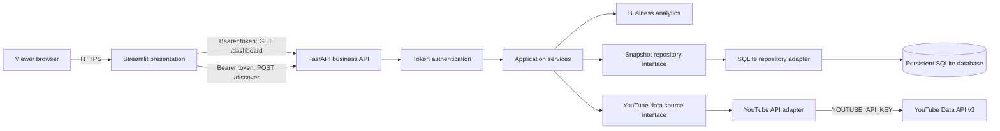
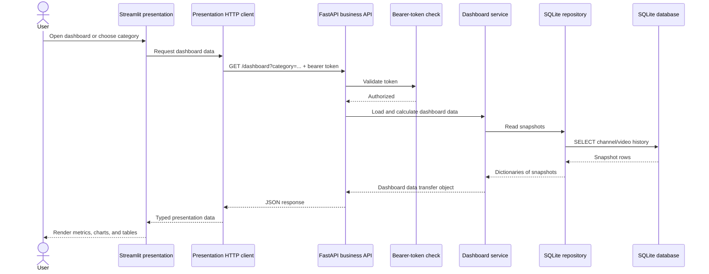
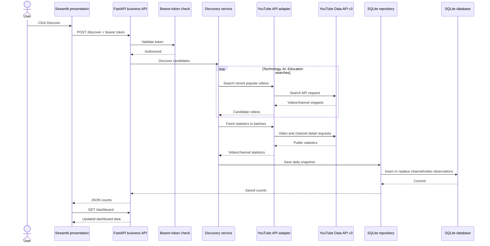

# YouTube Signals

YouTube Signals is a channel-discovery and analytics dashboard for US-English technology, artificial intelligence, and education content. It has two separately deployable Python projects: a Streamlit presentation and an authenticated FastAPI business service.

The first version discovers candidate channels through recent, popular videos, records public channel/video statistics in SQLite, and calculates observable signals such as subscriber growth, video velocity, engagement, and topic terms. It is a tracked sample, not a complete or official YouTube-wide trending ranking.

## Architecture



The presentation depends on the business service through HTTP only. The API owns the YouTube credential and database. This allows the projects to run in separate environments or on separate hosts; no Python business package or database access is required in the presentation deployment.
## Technology stack

| Technology | Project or layer | What it does here |
| --- | --- | --- |
| Python 3.10+ | Both projects | Implementation language for the API, business logic, presentation, and tests. |
| FastAPI | Business backend | Defines the HTTP API, validates requests, applies bearer-token dependencies, and serializes dashboard data as JSON. |
| Uvicorn | Business runtime | ASGI server that runs the FastAPI application. |
| Requests | Business integration | Makes HTTP calls from the backend to the YouTube Data API v3. |
| SQLite | Business persistence | Stores channel and video metric snapshots in a local database file; accessed with Python's built-in `sqlite3` module. |
| Streamlit | Presentation frontend | Renders dashboard navigation, filters, metric summaries, charts, tables, and the discovery action. |
| HTTPX | Presentation integration and API tests | Sends authenticated requests from Streamlit to FastAPI; its ASGI transport exercises API routes in tests without launching a server. |
| Pandas | Presentation | Shapes API-returned records into tables, histogram groups, and chart data. |
| YouTube Data API v3 | External data source | Supplies recent video search results and public video/channel statistics. |
| Setuptools | Python packaging | Builds and installs each project from its own `pyproject.toml`; editable installs support local development. |
| `unittest` | Tests | Python standard-library test runner for calculations, discovery orchestration, repository persistence, API routes, and the HTTP client. |

The architecture diagrams below show how these technologies interact. The `business/pyproject.toml` and `presentation/pyproject.toml` files are the source of truth for direct package dependencies; transitive packages are installed automatically by pip.

### Request flows

Dashboard load and filtering:



Discovery and snapshot collection:



## Projects and responsibilities

### `business/`

An installable FastAPI application and business package (`youtube-trends-business`). It owns:

- HTTP endpoints, request authentication, and API response serialization in `api.py`.
- Discovery orchestration in `discovery.py`.
- Dashboard data assembly in `services.py`.
- Pure growth, engagement, velocity, category, and title-term calculations in `analytics.py`.
- Data-transfer model in `models.py`.
- Interfaces (`Protocol`s) for data providers and snapshot storage in `ports.py`.
- YouTube REST integration in `youtube_api.py`.
- SQLite schema creation, reads, and writes in `sqlite_repository.py`.

The service layer depends on interfaces, not concrete HTTP or SQLite details. YouTube and persistence adapters implement those interfaces, which makes the workflow testable with fakes and keeps integrations replaceable.

### `presentation/`

An installable Streamlit application (`youtube-trends-presentation`). It owns:

- The dark dashboard theme, navigation, filters, metrics, charts, and tables in `app.py`.
- The HTTP client and presentation-side response model in `api_client.py`.
- User-facing handling of API connectivity and service errors.

The presentation does not import the business package, call YouTube, or access SQLite directly. It sends the bearer token to the API and receives dashboard JSON.

### Root files and tests

- `requirements.txt` is a convenient editable install of both local projects for development. Each project's dependencies are declared in its own `pyproject.toml`.
- `video_stats.py` is retained as a legacy Streamlit launcher. For the separated deployment flow, run `presentation/app.py` directly.
- `tests/` contains business calculations, discovery orchestration, SQLite persistence, API authentication/serialization, and presentation-client tests. Tests use fake API data or temporary databases and do not need a live YouTube API key.
- `.streamlit/config.toml` defines Streamlit's native dark theme.
- `.gitignore` excludes virtual environments, bytecode, `.egg-info` metadata, local SQLite snapshots, and `.env` files.

## API

Interactive API documentation is provided by FastAPI at `/docs` when the backend is running. The current endpoints are:

| Method | Path | Authentication | Purpose |
| --- | --- | --- | --- |
| `GET` | `/health` | Public | Lightweight deployment health check. |
| `GET` | `/dashboard` | Bearer token | Return calculated dashboard data. Accepts optional `category` query parameter. |
| `POST` | `/discover` | Bearer token | Search YouTube, fetch public statistics, and save today's snapshot. |

Dashboard and discovery routes require `Authorization: Bearer <DASHBOARD_API_TOKEN>`. If the token is unset, protected routes return `503`; an absent or invalid token returns `401`. Discovery returns `503` if the backend's `YOUTUBE_API_KEY` is not configured and `502` if a YouTube request fails. The YouTube adapter avoids returning request URLs in errors because those URLs contain the API key.

## Run locally as two services

Use two PowerShell terminals from the repository root. For local development, both projects can share the existing `venv`; the same commands can be adapted to separate virtual environments on deployed hosts.

### 1. Install and start the business API

```powershell
.\venv\Scripts\python.exe -m pip install -e .\business
$env:YOUTUBE_API_KEY = "your-youtube-data-api-key"
$env:DASHBOARD_API_TOKEN = "a-long-random-private-token"
$env:YOUTUBE_DATABASE_PATH = (Join-Path $PWD "youtube_trends.sqlite3")
.\venv\Scripts\python.exe -m uvicorn youtube_trends_business.api:app --host 127.0.0.1 --port 8000
```

The database path above reuses the existing repository-root `youtube_trends.sqlite3`. The API defaults to that same path if `YOUTUBE_DATABASE_PATH` is omitted. For a hosted backend, configure this variable to point to durable storage.

### 2. Install and start the Streamlit presentation

In a second terminal:

```powershell
.\venv\Scripts\python.exe -m pip install -e .\presentation
$env:YOUTUBE_TRENDS_API_URL = "http://127.0.0.1:8000"
$env:DASHBOARD_API_TOKEN = "the-same-long-random-private-token"
.\venv\Scripts\python.exe -m streamlit run .\presentation\app.py
```

Open the local URL printed by Streamlit, normally `http://localhost:8501`. Use the **Discover** button to collect a daily snapshot. Keep both terminal processes running while using the app. Stop each service from its own terminal with `Ctrl+C`.

For a single-environment development install, the root requirements file installs both projects:

```powershell
.\venv\Scripts\python.exe -m pip install -r .\requirements.txt
```

## Separate deployment

Install and deploy `business/` and `presentation/` independently:

- Business host: install `business/`, configure `YOUTUBE_API_KEY`, `DASHBOARD_API_TOKEN`, and a persistent `YOUTUBE_DATABASE_PATH`, then run Uvicorn. The service must be reachable from the presentation host.
- Presentation host: install `presentation/`, configure `YOUTUBE_TRENDS_API_URL` to the business API's base URL and set the matching `DASHBOARD_API_TOKEN`, then run Streamlit.
- Keep the YouTube API key exclusively on the business host. Give the token to both services through each platform's secret manager; do not commit secrets to Git.
- For networked deployments, terminate TLS with HTTPS at a trusted reverse proxy or platform ingress. Restrict backend network access with firewall/security-group rules so it is not broadly exposed. The API token is a simple shared-secret mechanism appropriate for this MVP; use an identity provider or stronger authorization design if the dashboard becomes multi-user or public.
- Persist the SQLite file across backend restarts. SQLite is suitable for this single-instance MVP; use a managed relational database if concurrent access or horizontal backend scaling is needed.

## Configuration reference

| Variable | Used by | Required | Description |
| --- | --- | --- | --- |
| `YOUTUBE_API_KEY` | Business | For discovery | YouTube Data API v3 key. Never configure this on the presentation host. |
| `DASHBOARD_API_TOKEN` | Both | Yes | Shared bearer token. Must match on both services. |
| `YOUTUBE_DATABASE_PATH` | Business | No | SQLite database file path. Defaults to `youtube_trends.sqlite3` at the repository root in a source checkout. |
| `YOUTUBE_TRENDS_API_URL` | Presentation | No | Business API base URL. Defaults to `http://127.0.0.1:8000`. |

## Discovery and data flow details

Each discovery run performs three fixed searches for recent videos, sorted by view count and scoped to US English: `technology`, `artificial intelligence`, and `education`. It keeps up to 25 results per query, de-duplicates videos by ID, collects video and channel statistics in batches of at most 50 IDs, and saves channel and video observations.

Snapshots use a canonical UTC date timestamp. Re-running discovery on the same UTC date replaces that day's snapshot rather than creating tiny intervals. Run discovery on separate days to build meaningful historical growth data. The database persists locally; it is not a data warehouse or shared service on its own.

## Dashboard metrics and limitations

- **Trending channels:** candidates surfaced by the fixed recent-video searches. Search results do not represent all YouTube channels or an official trending list.
- **Subscriber growth:** change between saved public subscriber-count snapshots, normalized to a weekly rate. It is unavailable until at least two valid observations exist. YouTube may round public subscriber totals.
- **Emerging creators:** discovered channels with a known subscriber total below 100,000. This is a display threshold, not a YouTube-defined category.
- **Video views per day:** observed view gain per day when repeat snapshots exist; otherwise, an estimate from lifetime views divided by video age.
- **Engagement:** public likes plus comments divided by views for discovered videos. It does not use private channel analytics, impressions, or watch time, and is not a channel-wide audience engagement rate.
- **Category activity:** count of discovered videos until repeat observations exist; then observed view increases for videos in the sample. It does not measure total category popularity across YouTube.
- **Topic insights:** frequent terms extracted from high-velocity video titles. They are ideas for investigation, not proof that a topic caused channel growth.

YouTube API quotas apply. Search requests consume substantially more quota than many read endpoints; check current Google Cloud quota usage before increasing search frequency or result limits.

## Tests

From the repository root, run:

```powershell
.\venv\Scripts\python.exe -m unittest discover -s tests -v
```

The tests cover weekly growth math, engagement and velocity calculations, discovery orchestration with a fake YouTube source, SQLite round-tripping with a temporary database, API health/auth/configuration behavior, and presentation-client JSON conversion. They do not make live YouTube API calls.
